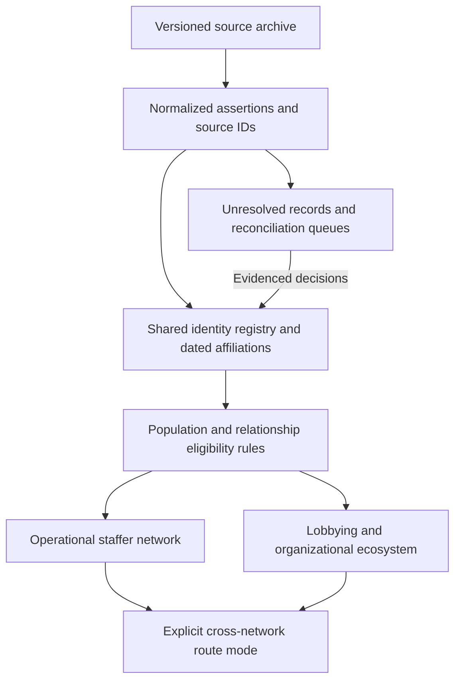

# Staffer network: implementation and evaluation framework

Date: September 8, 2026  
Status: candidate spine rebuilt and population-only evaluation completed; new identity/relationship adjudication and live release remain pending  
Objective: build a smaller, credible staffer network and a separately navigable lobbying and organizational ecosystem, using shared identities and a retained evidence archive.

## 1. Scope and success

Politico and Quorum establish the staffer population. LDA establishes the lobbyist population in the ecosystem; LDA presence never establishes staffer status. Payroll is consulted only when needed to answer a specific unresolved identity, career-history, or connection question. It does not routinely enrich every profile, seed a population, or drive broad tie discovery. LittleSis supplies typed relationships and broader ecosystem context.

**Source precedence, confirmed September 8:** defer to verified Politico Pro content when Quorum and Politico disagree about a person's staff role, title, or office. Retain Quorum as complementary evidence and use payroll for targeted reconciliation of conflicting roles, dates, offices, or same-name identities. Politico's preferred value is a sourced profile claim, not proof of present-day employment or permission to merge ambiguous people. Empty or unavailable Politico profiles do not override substantive Quorum evidence, and precise contradictory payroll observations require an explicit review outcome rather than silent suppression.

Success means fewer unsupported connections, recovery of supported missing connections, and explicit explanations for unresolved identities and gaps. A smaller node count, higher average degree, or shorter route is not itself evidence of improvement. True hubs and genuinely isolated people must remain possible.

This framework defines a successor design. It does not declare existing provisional employment, identities, or temporal relationships canonical. Existing publication and complete-history requirements remain applicable to consumers that require those claims. A supported individual episode must not be presented as a complete career history. Any change to older consumer gates must be documented in the implementation policy rather than inferred from this document.

### Observed starting point

The inspected checkout selects `staffer_social_network_20260908_v8_math_primary`. Its receipt contains 144,692 payroll-derived person nodes. The underlying spine receipt marks its records `REVIEW_REQUIRED` with zero canonical promotions. This is a candidate-node count, not a count of established unique humans or current staffers.

`staffer_person_inventory.py` admits the complete verified payroll spine, including people without model ties. The LittleSis/Quorum source catalog already retains assertions separately from model ties. The live router exposes review evidence as an option and currently defaults `include_review` to true. Map projection, routing, and outreach ranking have separate implementations and must be reconciled at their eligibility boundaries.

These are checkout findings, not a fresh census of the running service. Phase 0 must capture the actual served generation, identity overlay, source revisions, and effective options. Historical metrics in older design documents are not the new baseline.

## 2. Target architecture and population rules

Use separate graph projections over shared entities and facts. Do not build two independent identity registries. Keep person-to-office, person-to-organization, and person-to-activity incidences as primary records; derive qualified person-to-person connections only when requested or materialized under a declared rule.

| Population or view | Inclusion | Default behavior |
|---|---|---|
| Operational staffers | People with accepted staff-role evidence from Politico or Quorum, after role and identity checks | Show the selected current roster snapshot; retain historical staffers in an explicit historical scope |
| Lobbying ecosystem | LDA source people and their typed activity, registrant, and client associations | Show source identities with reconciliation status; filing presence does not assert current employment |
| Wider ecosystem | LittleSis people, organizations, and supported relationship types | Search the retained catalog; initially display the relevant neighborhood of selected entities |
| Bridge-only people | Evidence-backed people admitted by the bridge rule below; any payroll-only candidate must originate in a documented targeted question | Available in an explicit expanded route scope; excluded from operational staffer headcount; never generated by expanding the full payroll roster |
| Reconciliation workspace | Unresolved identities, ambiguous employers or dates, rejected matches, and proposed ties | Searchable and reviewable; unresolved claims excluded from qualified routes and scores |

A person can belong to multiple populations through separate supported roles. A historical staff role and a subsequent lobbying activity belong to one accepted person identity when the identity evidence supports that match. They do not imply simultaneous employment.

Directory presence alone is insufficient: distinguish staff, members, organizational contacts, empty records, and other role types. Interns do not count in the operational population or serve as route intermediaries during their internship. Internship episodes contribute zero work-proximity exposure, overlap duration, degree, or ranking weight. Retain the raw evidence for reconciliation. Someone who later holds a substantive staff role can qualify through that role, but their internship time remains excluded. A supervisor or coordinator of interns is not an intern solely because the title contains that word. Mixed or unclear titles require role-level review. Source-native identity is sufficient to retain a source record, but does not certify uniqueness across the registry.

**Bridge admission:** establish the person's identity, the relevant affiliations, and at least one independently qualified connection to an admitted person. A proposed intermediary on a route needs qualified connections for every incident hop used. No recursive population expansion from shared employer names. Evaluate candidate bridges against a fixed seed population and version the resulting admitted set. Bridge admission changes scope; it does not make someone a core staffer. Payroll-only candidates are considered only when a targeted evidence request requires them, not through a background sweep for possible intermediaries. A targeted payroll finding does not itself admit anyone.

### Payroll: consult only when needed

Use available Politico, Quorum, LDA, and relevant LittleSis evidence first, preserving each source's meaning. Open a payroll evidence request only for a concrete remaining question: distinguishing same-name records, checking a specific missing career interval, validating a proposed office overlap, or investigating a specific missing connection with an evidence-based lead. Low degree by itself is not sufficient reason to search payroll.

An explicit ambiguity trigger is an identical name in different offices or places during apparently overlapping periods. Compare individual payroll observations, office identity, titles, actual service dates, and shared-employee status. Two broad payment/reporting windows do not prove simultaneous service; legitimate shared employment is possible. Resolve to same person, different people, or unresolved from the supporting evidence. Do not automatically merge on name or automatically split on concurrent payments. Never sum internship observations into scored tenure while investigating the ambiguity.

Each request records `request_id`, subject IDs, question, trigger, existing evidence considered, bounded office/time scope, and the decision it could change. Return only relevant observations with source references and date precision. Outcomes are `SUPPORTED`, `CONTRADICTED`, `UNRESOLVED`, or `NO_RELEVANT_RECORD`; a missing record is not proof that employment or a relationship did not exist. Feed supported observations through the same identity, container, temporal, and relationship checks as other sources.

Retain the payroll archive and a lookup index as evidence infrastructure. Do not preload payroll people into either active network, attach all payroll histories to admitted people, scan the whole archive to manufacture bridges, or recursively expand from a lookup's results. Existing accepted payroll-supported facts may remain when they meet scope and evidence rules; record their specific evidentiary purpose during migration. Unjustified existing payroll-derived candidates remain in the archive/review plane.

Track payroll request count, trigger, records consulted, decision yield, and unsupported expansions. Every newly used payroll observation must link to a documented need. This controls activation of evidence, not just whether payroll nodes are drawn.

**Currentness:** retain source observation date, source reporting interval, role end date, and freshness separately. Display “reported as of [date]” when present-day employment is not established. Unknown or stale status stays labeled and does not silently enter a current-office destination roster. Freeze source-specific freshness rules during Phase 0 before evaluating candidates.

## 3. Minimum data contracts

| Record | Required fields and behavior |
|---|---|
| Source record | Source namespace and ID, generation, exact locator, payload hash, observed/ingested timestamps, supersession and extraction status |
| Payroll evidence request | Specific question and trigger, subject IDs, existing evidence, bounded lookup scope, returned support IDs, outcome, and downstream decision IDs |
| Person | Stable internal person ID, names/aliases, source bindings, identity status, decision references; ID independent of current employer or selected view |
| Identity decision | Candidate IDs, merge/separate/unresolved decision, evidence references, reviewer or rule version, timestamp, contradictions, superseded decision |
| Organization or office | Stable ID, entity type, source IDs, aliases, jurisdiction/chamber, officeholder or organizational succession where applicable; unresolved strings retained separately |
| Affiliation | Person, container, relation type, title, date bounds and precision, observation date, identity/container/fact acceptance states, supporting records |
| Relationship | Endpoints, type and direction, supporting affiliation/activity IDs, temporal basis, evidence class, support family, eligibility decision and reason |
| Population membership | Person, population, current/historical/unknown status, role evidence, admission rule version, effective interval and exclusion reason |
| Graph build | Input hashes, identity/fact/policy revisions, as-of date, scope, admitted node/edge counts, exclusions by reason, output hashes, evaluation status |

Keep identity acceptance, fact acceptance, temporal eligibility, and route eligibility as separate fields. A numerically verified record can still be unresolved. Avoid one generic confidence score that combines these questions. Any numeric confidence must have a stated calibration target; routing costs are preferences, not probabilities of acquaintance or access.

Merges must be reversible. Preserve original IDs and evidence; maintain redirect and split histories. A split must redistribute facts from their original source bindings rather than copy every merged fact onto both resulting people. Recompute affected memberships, edges, routes, scores, and caches after either operation. Conflicting explicit keep-separate decisions block automated merging.

## 4. Identity, affiliation, and tie cleanup

### Identity and affiliation sequence

1. Normalize names for candidate retrieval while retaining raw forms, suffixes, initials, and name changes. Names alone cannot establish a cross-source merge.
2. Compare source identifiers, dated career transitions, office and role evidence, and independently corroborating references. Copied biographies are one evidence family.
3. Evaluate the whole proposed identity cluster for contradictory histories, birth dates where available, suffixes, and saved separations. Valid-looking pairs do not authorize unchecked transitive merges.
4. Resolve containers before inferring overlap. Distinguish similarly named member offices, predecessor organizations, committees, local branches, and parent organizations.
5. Preserve observed intervals and uncertainty. Union duplicate supported intervals within a person/container/relation before calculating overlap. Missing intervals remain gaps; adjacent half-open intervals do not overlap.
6. Emit separate accepted, rejected, and unresolved decisions with reproducible reasons. Queue extraction failures separately from source omissions and unavailable evidence.

### Relationship policy

| Evidence | Retained meaning | Routing and scoring treatment |
|---|---|---|
| Explicit supported interpersonal or coworker statement | The exact stated relationship, direction if relevant, and dated validity | Eligible only after applicable checks; user assertions retain their own provenance and retraction history |
| Supported overlap in the same resolved office or team | Historical or current co-service evidence | Eligible under a named temporal rule; label as co-service, not confirmed acquaintance |
| Named on the exact same LDA activity | Co-reported lobbying activity | Eligible in ecosystem and cross-network modes after endpoint checks; no employment inference |
| Same firm or organization without qualified overlap | Shared affiliation | Context only by default; no automatic person-pair edges |
| LittleSis employment or board role | Person-to-organization affiliation | Visible in ecosystem; shared organization alone does not establish interpersonal access |
| LittleSis explicit personal relationship | The source's specific asserted relationship | Candidate for qualified ecosystem use after identity, source-support, and temporal review |
| Donation, ownership, or funding | Directed financial/ownership relation | Ecosystem context; excluded from interpersonal introduction routes by default |
| Shared policy interest or category | Topical similarity | Discovery/filtering context; excluded from qualified introduction routes |
| Uncertain identity, employer, or possible-only overlap | Candidate assertion | Review workspace; no qualified temporal edge |

Large affiliations remain incidence groups, avoiding an automatic clique of all members. Group size is an audit signal, not proof that a tie is false. A person-to-person projection must identify the evidence that supports that particular pair and the grouping resolution used.

Repeated records retain provenance but do not create extra neighbors. Collapse amended/superseded filings at their appropriate source identity. For repeated activity reporting, distinguish distinct events from repeated support for the same event. Report raw support count, independent evidence-family count, and unique neighbor count separately. Do not sum them into “relationship strength.”

### Two-sided cleanup queues

**Excess-tie review:** select the top 1% by qualified unique degree within comparable population/time/coverage strata, plus records with anomalous identity-cluster sizes, large-container exposure, or sudden degree increases. Explain degree by relation type, employer/team, time interval, source family, and derivation rule. Review likely identity collisions and bulk affiliation projections first. The percentile prioritizes review; it never deletes edges automatically.

**Missing-tie review:** select zero-degree core staffers and the lowest degree decile within comparable strata, plus profiles with known unlinked career records. Review admitted-source evidence for split identities, unnormalized offices, missing dates, omitted assertions, and extraction failures. Consult payroll only if that review establishes a specific question and bounded lead under the payroll request contract. Record one of: recovered supported tie, correct isolation, source coverage gap, unresolved identity, unresolved container/date, or extraction defect. Do not manufacture ties to meet a density target.

Queue priority combines potential false or missing ties, affected routes, evidence availability, and reviewer effort. Reserve capacity for both queues so highly visible hubs do not consume the entire cleanup effort. Start with an equal number of high-degree and sparse profiles in the pilot; adjust only from observed review yield.

### Two dimensions of work connection

The work-connection measure has two dimensions: **proximity in work** and **time actually worked together**. Proximity means organizational working closeness (for example a supported direct team versus broader co-service), not physical distance, seniority, source popularity, or the number of filings. A shared employer is insufficient to infer a direct team. When team evidence is absent, retain the broader supported proximity class or leave it unresolved.

The current implementation already combines container proximity and a saturating duration curve, with additional identity-tier and shared-role factors. This design refines the eligibility and attribution of those inputs rather than assuming a new graph layout alone fixes the math. Identity certainty governs whether evidence is accepted; it should be reported separately from work closeness. Any removal or reinterpretation of current identity-tier or shared-role factors must be tested in a shadow model and documented.

For a constant supported work context, the simple explanation is: closer work plus longer shared service means a stronger work tie; additional time has diminishing returns. Preserve both raw dimensions alongside any combined score. No recency decay is introduced by this requirement: how long people overlapped and how long ago it happened are different questions. LDA activity and other ecosystem relations retain their own semantics and cannot supply invented employment duration.

For changing work contexts, never apply the closest proximity observed for one brief stint to every year of a broader association. Partition the accepted shared-service calendar into non-overlapping intervals, remove intern periods, and assign the strongest actually supported proximity in each interval. Duplicate sources and overlapping affiliations do not count a calendar day twice.

One proposed shadow formula is `effective_days = sum(interval_days * interval_proximity)` and `work_score = 1 - exp(-effective_days / tau)`, with proximity between 0 and 1. Unknown proximity is withheld, not guessed as zero; an unsupported relationship has no qualified score. This formula is an evaluation candidate, not an implemented or calibrated change. It is monotone in both dimensions and saturates; sufficiently long weaker proximity can approach the same upper bound as close work, a tradeoff to assess before adoption. Compare it against the existing proximity-times-duration formula on fixed cases. Keep the proximity rubric and duration scale explicit; do not claim a probability of personal acquaintance.

Required math checks: increasing shared time at fixed proximity cannot weaken a tie; increasing proximity at fixed time cannot weaken it; duplicate observations leave the score unchanged; non-overlapping careers produce no co-service tie; internship-only overlap contributes zero; a brief close stint cannot upgrade distant years; absent dates do not become continuous tenure. Evaluate same-team versus broad-office ordering and short-close versus long-distant tradeoffs with reviewed cases before choosing parameters.

### Quorum and Politico Pro reconciliation

Compare the retained Quorum source IDs with verified Politico Pro profile UUIDs. Preserve each source's fields, source timestamp and unavailable-profile status. Normalize names for candidate retrieval, then compare office/team, title, career evidence and dates. Distinguish exact source agreement, compatible title variants, role changes, office changes, name collisions, unavailable profiles and source-only records. Repeated source descriptions are corroboration, not extra people or extra time.

The retained Quorum legacy seed has no per-role employment dates. Its corpus generation time is an ingestion timestamp, not a service interval. An undated Quorum role differing from a September Politico profile cannot by itself establish simultaneous employment or a contradiction. Route those cases to a date/evidence queue; consult payroll only for specific remaining ambiguities with a bounded lead.

For each retrieved Quorum/Politico candidate, first resolve whether the records describe the same person. On an accepted identity, use Politico Pro as the preferred role/title/office source and retain the differing Quorum assertion with its unknown date. Use payroll where needed to explain a move, promotion, overlapping-office claim, or same-name conflict. Record the preferred value, its Politico support, the Quorum discrepancy, payroll evidence if consulted, and whether the discrepancy is explained or still unresolved. A preferred Politico value may be displayed with its source date while its Quorum discrepancy remains open; an unresolved cross-source identity must remain separate. Do not convert an undated Quorum role into historical service merely because it differs from Politico.

Output a complete source-disposition ledger, candidate crosswalk, intern exclusions, unmatched-source inventories, and targeted evidence requests. Strong agreement can prioritize an identity proposal, but production aliases require the applicable acceptance rule. Ambiguous candidates stay separate, and a missing candidate is not proof that no match exists. Source-level comparison can complete while identity adjudication remains unresolved; report those statuses separately.

## 5. Implementation work packages

Owners below are responsibilities for implementation, not assignments to additional agents. Each stage produces an independently inspectable artifact before the next consumer is switched.

| Stage | Work and dependencies | Deliverable | Exit condition |
|---|---|---|---|
| 0. Baseline and policy | Capture served state and all source manifests; freeze current/historical scope, freshness, relation rules, and evaluation splits | `baseline_manifest.json`, source/population overlap census, initial decision ledger, frozen evaluation plan | Every held input accounted for; baseline routes and scores reproducible |
| 1. Shared identities | Build stable registry and reversible source bindings; resolve candidate clusters and container IDs | `person_registry`, `source_bindings`, `identity_decisions`, `container_registry` | Identity gates pass for each automated rule being enabled; unresolved records remain accessible |
| 2. Population separation | Apply explicit core/ecosystem/bridge rules over Stage 1; retain all archive evidence | Membership/exclusion ledgers and independently buildable view manifests | All membership decisions traceable; no LDA-only or payroll-only record becomes a core staffer |
| 3. Affiliation and tie qualification | Normalize dates and support families; implement typed relationship eligibility and targeted payroll requests over Stages 1–2 | Affiliation ledger, payroll request/outcome ledger, qualified relationships, rejected/candidate ties, high/sparse review queues | Relationship and temporal gates pass; duplicate support cannot inflate degree or duration; payroll used only for documented needs |
| 4. Consumer integration | Feed the same policy decisions into display, search, routing, exports, groups, and ranking | Shadow staffer/ecosystem views, cross-network mode, explanation panels, scope-aware cache keys | Consumer parity and route correctness pass; scope-specific score denominators visible |
| 5. Evaluation and rollout | Compare baseline and candidate on fixed cohorts; review identity/tie/route changes | Evaluation report, signed-off decision record, candidate release manifest, rollback manifest | Applicable release gates pass; failed classes remain disabled or in review |

Data engineering owns conservation and schemas; reconciliation owns identity/container decisions; graph engineering owns projections and route semantics; evaluation owns frozen labels and independent checks; the product owner owns scope and final release decisions. One person may perform several roles, but evaluation labels must not be derived from the candidate algorithm's answers.

### Integration points in this repository

| Existing component | Intended integration |
|---|---|
| `fec/surfaces/staffer_person_inventory.py` | Preserve complete inventory while applying explicit population membership to operational consumers |
| `fec/surfaces/staffer_identity_resolution.py`, `staffer_identity_auto.py`, `staffer_payroll_identity.py` | Reuse evidenced decisions; introduce stable registry bindings and reversible cluster migrations; activate payroll lookup through a bounded request rather than universal enrichment |
| `fec/surfaces/staffer_source_catalog.py`, `staffer_lda_catalog.py` | Preserve source-native records and typed ecosystem incidences |
| `fec/surfaces/staffer_network_scope.py` | Extend scope policy beyond presentation filters and intern exclusion |
| `fec/surfaces/staffer_routing_evidence.py`, `staffer_overlap_routes.py`, `staffer_activity_index.py` | Consume shared qualification decisions; retain exact activity and interval evidence |
| `fec/surfaces/staffer_routing.py`, `staffer_office_routes.py` | Enforce mode, endpoint, intermediary, date, and relation eligibility in the complete search |
| `fec/surfaces/staffer_people_graph.py`, `staffer_live_service.py`, `staffer_live/*` | Expose separate networks, scope badges, evidence reasons, and reconciliation progress |
| `fec/surfaces/staffer_graph_snapshot.py`, `staffer_outreach_ranking.py` | Bind the complete selected graph and score denominator to the new scope/policy manifest |

Introduce one shared policy module or equivalent service for population and relationship eligibility. Do not duplicate admission logic in JavaScript, route adapters, and ranking code. Preserve sparse activity/group indexes rather than generating every pair. Complete routing and evaluation must use complete eligible indexes, never the bounded map sample.

## 6. Evaluation protocol

### Frozen review set

Separate development cases from a locked holdout before tuning. Split by underlying person cluster, affiliated event/container where practical, and source generation to limit leakage. Include a later-period slice to test freshness and career transitions. Existing named demonstrations are regression cases, not unseen evaluation evidence.

Begin development with 50 high-degree profiles, 50 sparse profiles, and a small set of contrasting routes. Construct the holdout to include cross-source merges, hard same-name negatives, name changes, temporal contradictions, large and small offices, current/historical staff, lobbyists, bridge-only people, and differing source coverage.

For statistical precision gates, draw a probability sample of accepted predictions separately from the purposive hard-case set. Use one-sided 95% exact binomial lower bounds on the probability sample; use appropriately weighted estimates for stratified samples. Do not pool oversampled hard cases into an unweighted population precision claim. Report all hard-case failures separately.

Suggested starting holdout: 300 accepted automatic identity decisions sampled from the release scope; 100 hard identity negatives; 100 accepted ties for each enabled inferred relationship class; 100 independently established positive identity/relationship cases to assess missed matches; and 100 route scenarios including unreachable, cross-network, current-office, and historically connected cases. Expand any sample that cannot support the applicable bound. Insufficient evidence is `NOT_EVALUATED`, never `PASS`.

Identity reviewers label same/different/unresolved and cite evidence. Relationship reviewers label the exact relation, endpoints, date support, and eligibility, rather than answer whether people “know each other.” Two reviewers independently label the holdout; adjudicate disagreements and report unresolved cases and agreement. Do not silently discard ambiguous cases: report abstention/coverage separately and treat an unresolved accepted prediction as unverified for release precision.

### Scorecard and proposed release gates

These thresholds are proposed engineering targets, not measured results. Freeze them before the holdout is opened. Any revision requires a recorded rationale and a fresh evaluation slice; do not lower a threshold merely to pass a failed candidate.

| Metric | Definition | Proposed gate |
|---|---|---|
| Evidence conservation | Every source record has a retained record or explicit extraction/quarantine/supersession disposition | 100% accounted for; zero unexplained loss |
| Population traceability | Membership and exclusion decisions have accepted support and rule versions | 100%; zero LDA-only/payroll-only core admissions |
| Payroll activation | Newly used payroll observations are linked to a concrete evidence request; migrated facts have documented purposes | 100% traceability; zero automatic payroll population expansion, universal enrichment, or unrequested broad tie discovery |
| Intern exclusion | Intern-only population membership, internship-derived duration/weight, and internship-based route eligibility | Zero; substantive later roles assessed separately |
| Two-dimension math | Proximity/duration monotonicity, interval attribution, duplicate invariance, and missing-date behavior | All declared invariants pass; parameter tradeoffs reviewed on frozen cases |
| Automatic identity precision | Correct accepted merges / all reviewed accepted merges | One-sided 95% lower bound at least 99%; no known contradictory cluster or violation of keep-separate decisions |
| Identity recovery | Accepted correct merges / independently labeled same-person cases | At least 90% on frozen positive set; report by source pair and ambiguity stratum |
| Container correctness | Correct normalized containers / sampled accepted container decisions | One-sided 95% lower bound at least 95%; zero known cross-officeholder collisions |
| Qualified tie precision | Correct endpoints, relation meaning, and required temporal support / reviewed accepted ties | One-sided 95% lower bound at least 95% for each enabled inferred class |
| Supported tie recovery | Recovered eligible ties / independently established eligible positive ties | At least 90% on frozen positive set; expose denominator and uncertainty |
| Temporal integrity | Invalid, fabricated continuous, possible-only-as-guaranteed, or adjacent-only overlap edges | Zero violations in complete deterministic checks; date correctness also assessed by tie review |
| Support invariance | Re-ingesting duplicate support changes neighbors, unioned overlap, or scores | Zero change, except provenance counts |
| Route eligibility | Every hop passes the selected mode and qualification policy | 100% across complete validation and reviewed routes |
| Route search correctness | Returned path matches an independent exact reference on small graphs; no sampled graph used as exhaustive evidence | 100% on regression/reference suite; pending or truncated searches never labeled unreachable |
| Scope isolation | Enabling ecosystem display changes staffer-only routes, ranks, or roster | Zero change for otherwise identical staffer-only queries |
| Reproducibility | Identical source/identity/policy/as-of inputs produce identical memberships and relationships | Exact content equality; numerical score differences within declared algorithm tolerance |
| Serving performance | Same hardware, workload, and cache regime; p50/p95 search/profile/route latency and memory | No unexplained p95 latency or peak-memory regression above 20%; correctness cannot be traded for a cutoff |

With 300 correct decisions out of 300 in an independent simple random sample, the one-sided 95% exact lower bound is approximately 99.0%; any errors may require more evidence or disabling the failing automated rule. A pooled result does not license an untested new source-pair rule. Report source-pair/rule results and retain review for insufficiently evaluated strata.

Positive-set recovery is benchmark recall, not a claim to know every real-world relationship. Missing source coverage cannot establish that a person has no connections. A partial graph can pass for its clearly declared scope; omitted classes must be visible, not hidden inside an overall PASS.

### Network effects and causal comparisons

Compare four builds on the same frozen inputs and as-of date: current baseline; population separation only; separation plus identity/container cleanup; and the full candidate with qualified ties. This distinguishes effects of removing out-of-scope people from actual identity or relationship improvements.

Report both the common-person cohort and each build's full admitted population. Measure unique degree by relation type, isolates, component sizes, source concentration, largest affiliation groups, bridge dependence, qualified versus context-only neighbors, and top-ranked membership changes. Explain large changes using decision and evidence IDs. Raw PageRank values across different node universes are not directly comparable; compare order within matched cohorts and label each scoring universe.

Audit removed and recovered ties in both high-degree and sparse cohorts. Record the reason for every route lost, gained, or shortened: population change, corrected identity, corrected dates/container, rejected bulk affiliation, recovered evidence, or unresolved. A lost unsupported route is an improvement; a newly shortened route is useful only when its new hops are supported.

Run sensitivity checks for source removal, uncertain-date handling, and relation inclusion. Count how many routes depend on a single evidence family or bridge person. Sensitivity informs fragility labels; it does not justify weakening qualification rules to retain connectivity.

## 7. Release, maintenance, and rollback

Build a shadow candidate from immutable snapshots. Keep generation-specific source, identity, fact, policy, as-of, and view revisions in all manifests and cache keys. During shadow operation, compare candidate and baseline using the same queries without mixing their state.

Release the default staffer view only after its gates pass. Enable ecosystem and cross-network modes with their own evaluated relation classes. The user must see whether a result is staffer-only, ecosystem, or cross-network; historical and bridge-only participants need visible role/date labels. Headcounts distinguish retained source records, unresolved identities, and admitted people.

Select a release through an atomic manifest switch covering all coupled projections and indexes. Retain the previous manifest and artifacts. A critical identity collision, unexplained evidence loss, invalid temporal edge, stale assertion served as active, or consumer policy mismatch blocks the affected candidate and triggers rollback of an affected live release. Restore the previous coherent generation rather than combine an old graph with new alias mappings.

Refreshes rerun source conservation, scope eligibility, identity conflict checks, tie qualification, and affected-route regression cases. Track changes in identity decisions, source coverage, degree distributions, and route/rank results against the previous release. New source types and new automatic matching rules require their own evaluation before activation. Review intervals should follow source update cadence; no recurring job is created by this framework.

## 8. Completion checklist and first implementation increment

The framework is implemented when both networks share stable identities; population admission is explicit; contextual affiliations cannot silently become route edges; every qualified connection has inspectable evidence; both cleanup queues have measured outcomes; and an independently reproducible evaluation and rollback package accompanies the release.

The first implementation increment is **Phase 0: an inventory and tie-origin audit**. It should produce:

1. Source records, provisional identities, accepted people, and population memberships, including intersections without double-counting humans.
2. Current, historical, stale, unknown, bridge-only, and unresolved counts with explicit denominators.
3. Ties and unique neighbors by derivation rule, evidence class, source family, container size, and date quality; distinguish existing payroll contributions from proposed need-based lookups. Inventory existing artifacts without initiating a new payroll sweep.
4. A 50-profile high-degree queue and a 50-profile sparse queue, each with evidence-backed explanations and proposed dispositions.
5. Baseline route and ranking fixtures, source manifests, and the frozen evaluation protocol.

The [candidate spine rebuild report](</C:/Users/pgoff/OneDrive/Desktop/Melange Systems/STAFFER_SPINE_REBUILD_REPORT_20260908.md>) records the implemented source/identity/role registry, separate populations, intern exclusions, preserved decisions, targeted payroll evidence, source cleanup, and complete population-only baseline graph comparison. Integrity and eligibility checks passed. It does not claim completed new identity adjudication, qualified new relationships, or live release. The earlier [Quorum/Politico source-comparison report](</C:/Users/pgoff/OneDrive/Desktop/Melange Systems/STAFFER_QUORUM_POLITICO_RECONCILIATION_20260908.md>) remains the provenance for the candidate crosswalk and prepared payroll questions.

## Local references

- [Selected graph adapter](fec/surfaces/staffer_graph_snapshot.py)
- [Complete source-person inventory](fec/surfaces/staffer_person_inventory.py)
- [Source catalog](fec/surfaces/staffer_source_catalog.py)
- [Live router](fec/surfaces/staffer_routing.py)
- [Outreach ranking consumer](fec/surfaces/staffer_outreach_ranking.py)
- [Selected graph receipt](audits/staffer_network/staffer_social_network_20260908_v8_math_primary/staffer_social_network_receipt.json)
- [Payroll spine receipt](audits/staffer_network/hill_personnel_spine_20260908_v8_primary/hill_personnel_spine_receipt.json)
- [Earlier employment promotion design and constraints](STAFFER_NETWORK_EXPANSION_DESIGN_20260901.md)
- [Earlier metrics, for historical context](STAFFER_NETWORK_METRICS_20260901.md)
